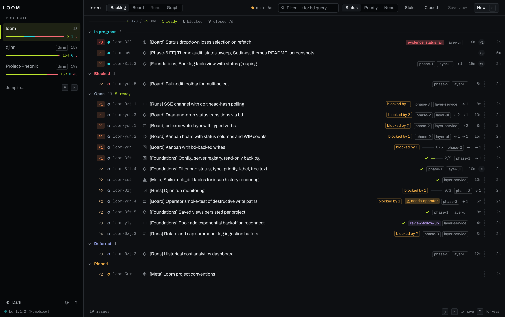
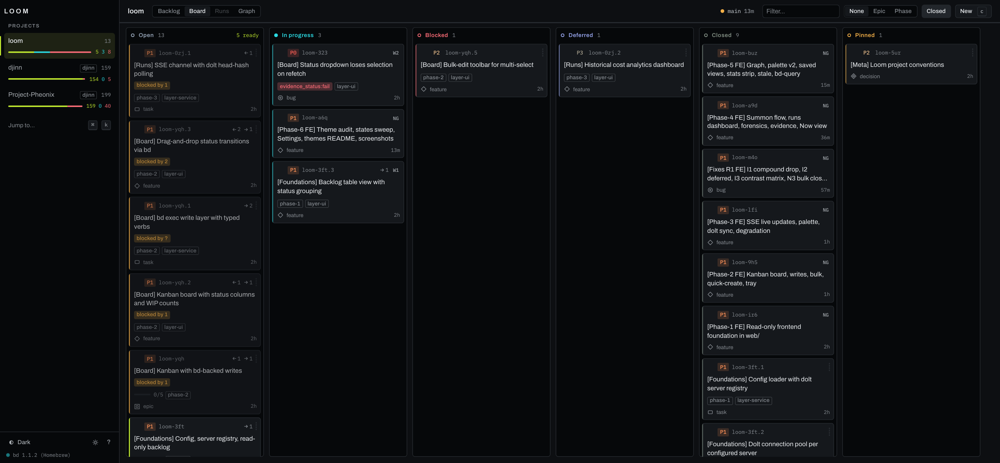
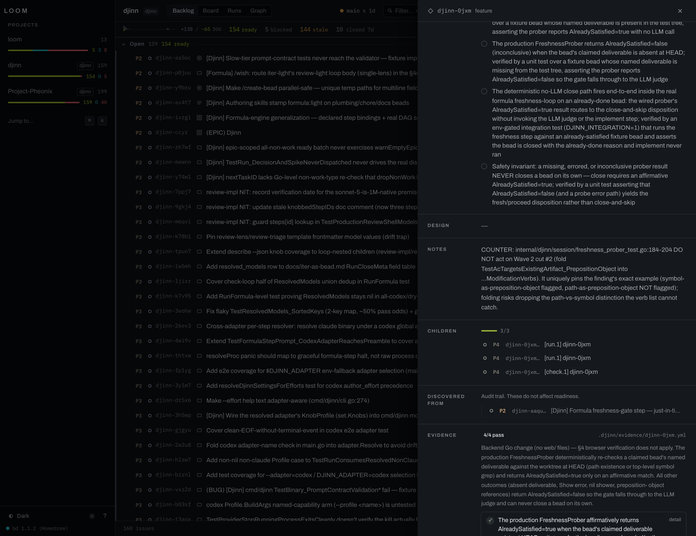
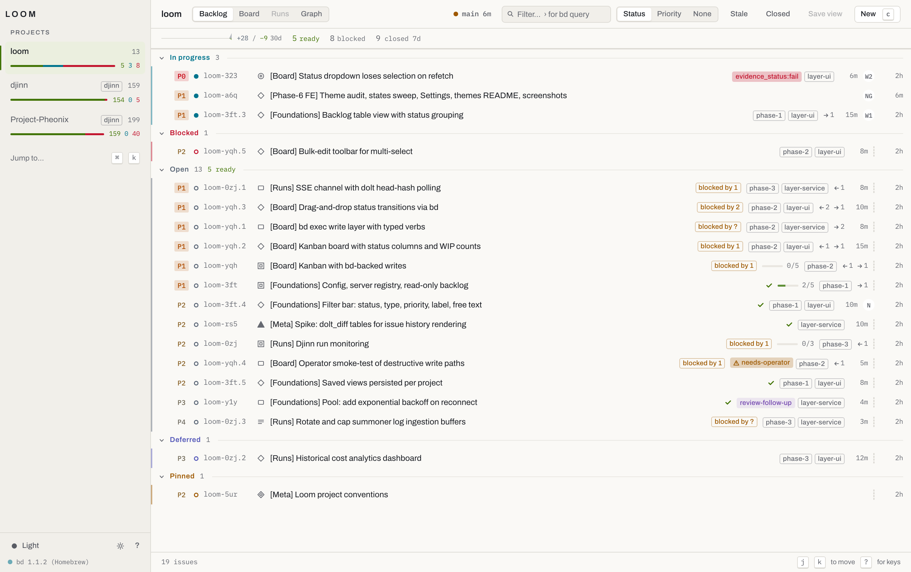
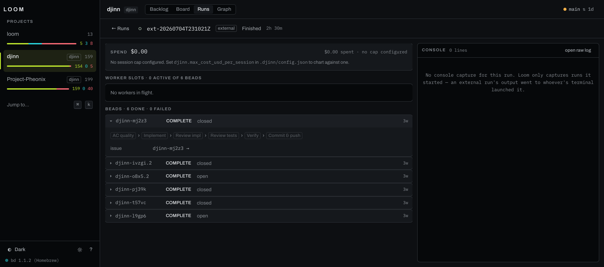

# Loom

A web UI for [beads](https://github.com/gastownhall/beads) (`bd`), the
dependency-aware issue tracker backed by Dolt. bd is built for agents and the
command line; Loom is for the person who manages the backlog: see every
workspace at once, filter and group issues, groom and prioritise them, drag
them across a board and follow their dependencies.

Loom is one local binary with the web UI inside it. Point it at any `bd init`
workspace and it reads the issues straight from that workspace's Dolt database.
Every write goes through `bd`, so bd stays the only thing that changes your
data.

## Screenshots

| | |
|---|---|
|  |  |
| **Backlog** — filter, group and groom | **Board** — drag between statuses, WIP counts |
|  |  |
| **Detail** — four prose fields, AC checklist, typed deps | **Light theme** |

## Quick start

**Requirements:**

- Go **1.26.4 or newer** (the version `go.mod` declares)
- Node **22.22.2+, 24.15+ or 26+** and npm, to build the web UI (the floor jsdom and vitest set)
- `bd` **1.3.2** on `PATH` ([install beads](https://github.com/gastownhall/beads))

Clone the repository and build from its root:

```bash
git clone https://github.com/kurofune/beads-loom.git
cd beads-loom
npm ci --prefix web     # install the web UI's dependencies
make build              # build the UI, embed it, build ./loom
./loom                  # → open http://127.0.0.1:7333
```

The startup log says `serving embedded frontend` when the UI is inside the
binary. If it says `no frontend embedded; serving the API only`, the web build
did not run: run `npm ci --prefix web`, then `make build` again.

A release archive from
[github.com/kurofune/beads-loom/releases](https://github.com/kurofune/beads-loom/releases)
holds the same binary with the UI inside. Extract it and run `./loom`; you need
only `bd` on `PATH`.

Do not install with `go install`: it does not run the web build, so the binary
it makes serves the API only.

### Your first workspace

With no config file, Loom lists no projects and discovers beads workspaces
under the directory you start it in and under your home directory, three levels
deep. So the shortest path to a populated UI is:

```bash
mkdir ~/scratch-tracker && cd ~/scratch-tracker
bd init                 # embedded Dolt; also creates a git repo
bd create "Try Loom" -t task -p 2
/path/to/loom           # this workspace is the first project in the UI
```

To get a config file you can edit:

```bash
./loom --write-default-config          # → ~/.config/loom/config.yaml
```

## Supported workspaces

Loom supports both storage modes bd offers. It reads `.beads/metadata.json` to
tell which one a workspace uses; you configure nothing.

| Mode | Created with | How Loom reads it |
|---|---|---|
| **Embedded** (bd's default) | `bd init` | Opens the Dolt database in `.beads/embeddeddolt/` directly, one short read at a time, and releases bd's store lock between reads so `bd` commands never wait long. No server process. |
| **Server** | `bd init --server`, then `bd dolt start` | Connects over SQL to the workspace's own Dolt server on the port in `.beads/dolt-server.port`. |

In both modes every write — create, edit, close, comment, dependencies, Dolt
push and pull — runs a `bd` command in the workspace.

## Architecture

```
                    ┌─────────────────────────────────────────┐
   browser ────────▶│  loom (single Go binary, localhost)     │
   :7333            │                                         │
                    │  httpapi ── chi router, CSRF guard      │
                    │     │                                   │
                    │     ├── queries ──── SQL reads ─────────┼──▶ dolt sql-server
                    │     │                                   │    (per project, dynamic
                    │     │                                   │     port) or embedded Dolt
                    │     ├── bdexec ───── writes ────────────┼──▶ `bd` CLI
                    │     │                                   │
                    │     ├── sse ──────── /api/events ───────┤
                    │     │    └─ poller: dolt_hashof_db 1s   │
                    │     │                                   │
                    │     └── integrations (optional) ────────┤
                    │                                         │
                    │  webembed ── the React app, go:embed'd  │
                    └─────────────────────────────────────────┘
```

Two rules shape everything:

1. **Reads are SQL, writes are `bd`.** Loom queries each project's Dolt
   database directly for speed, but never writes to it. Every change runs
   `bd`, which owns ID allocation, event emission, dependency cycle checks and
   Dolt commit policy.
2. **A dead project is a degraded state, not an error.** Each project resolves
   and health-checks independently; one unreachable database never blocks the
   others, and the UI shows a reason you can act on.

| Package | Responsibility |
|---|---|
| `internal/config` | YAML config, defaults, validation |
| `internal/discovery` | Finds beads workspaces under the configured roots |
| `internal/registry` | Project registry, embedded and server Dolt resolution, connection pools, health |
| `internal/queries` | All reads: issues, deps, labels, stats, graph, dolt sync |
| `internal/bdexec` | All writes: typed `bd` verbs behind a mockable Runner |
| `internal/sse` | Event hub + per-project `dolt_hashof_db()` pollers |
| `internal/httpapi` | HTTP routes, JSON contract, CSRF guard, static serving |
| `internal/webembed` | The built frontend, embedded |

## Flags and environment

| Flag | Default | Meaning |
|---|---|---|
| `--config <path>` | `$LOOM_CONFIG`, else `~/.config/loom/config.yaml` | Config file location |
| `--listen <addr>` | from config, else `127.0.0.1:7333` | Override the listen address |
| `--write-default-config` | — | Write the default config and exit. Refuses to overwrite |
| `--version` | — | Print version, commit, build date and platform |

| Variable | Meaning |
|---|---|
| `LOOM_CONFIG` | Config path (overridden by `--config`) |
| `LOOM_STATE_DIR` | Where integration state (run records, console captures) lives. Default `~/.local/state/loom` |

## Configuration reference

`~/.config/loom/config.yaml`. A file needs at least one of `projects:` or an
enabled `discovery:` block; every other key is optional.

The shipped default (what Loom uses with no file, and what
`--write-default-config` writes) lists no `projects:` and turns discovery on
over the working directory and `~` at depth 3:

```yaml
discovery:
  enabled: true
  roots:
    - "."      # the directory loom was started in
    - "~"      # your home directory
  depth: 3     # directory levels below each root
  interval: 5m
```

Every key, with its default (the `integrations:` keys are in
[Integrations](#integrations)):

```yaml
# Address the API and UI bind to. Loom is a local tool; binding a public
# interface is not recommended and the CSRF guard will reject writes whose
# Host header does not match this value.
listen: 127.0.0.1:7333          # default

# servers: only needed for REMOTE Dolt servers at a fixed host:port.
# Local projects resolve their port from .beads/dolt-server.port at query time.
servers:
  - name: shared                # required, unique; referenced by projects[].server
    host: 127.0.0.1             # default 127.0.0.1
    port: 3308                  # required when kind is remote (1-65535)
    user: root                  # default root
    password: ""                # default empty
    kind: remote                # local | remote; default remote

projects:                       # optional while discovery is enabled
  - name: myproject             # required, unique; appears in the UI and in URLs
    workdir: ~/code/myproject   # required; where .beads/ lives. ~ and relative paths are expanded
    database: myproject         # default: dolt_database from .beads/metadata.json
    server: shared              # default: unset ⇒ resolve locally (see below)

discovery:                      # finds beads workspaces you did not list
  enabled: true                 # a config file with no discovery: block has discovery off
  roots: [".", "~"]             # required when enabled; "." = working directory, ~ expanded
  depth: 3                      # directory levels below each root (1-10), default 3
  exclude: []                   # extra globs; dot-dirs, node_modules, vendor, dist,
                                #   build, target and .Trash are always skipped
  interval: 5m                  # rescan cadence, minimum 30s, default 5m
```

Quote `"~"` in YAML: a bare `~` is YAML's null.

Validation is strict and errors always name the file: unknown `server:`
references, duplicate names, missing `workdir`, out-of-range ports and invalid
integration settings are all rejected at startup rather than at first use.

### How a project's database is resolved

**Embedded workspaces** (`dolt_mode: "embedded"` in `.beads/metadata.json`, the
`bd init` default). Loom opens `.beads/embeddeddolt/<database>` in process. The
database name is `dolt_database` from `metadata.json`. A port file left behind
by an earlier server-mode life is ignored.

**Server workspaces with no `server:` key — the normal server case.** bd runs a
*separate* Dolt server per workspace and assigns it a **dynamic port** that
changes whenever the server restarts. So Loom does not cache an address:

1. Read `<workdir>/.beads/dolt-server.port` — the port, re-read on **every**
   health check.
2. Read `dolt_database` from `<workdir>/.beads/metadata.json` for the database
   name. (The `dolt_server_port` key in that file is deprecated and often stale;
   Loom deliberately ignores it.)
3. Connect to `root@tcp(127.0.0.1:<port>)/<database>` with a 2s dial timeout.

If a query later fails with a *connection* error, Loom re-reads the port file
once — because the server may have restarted somewhere else — and retries. If
that fails too, the project is marked unreachable with a reason and the others
carry on. A SQL-level error (bad query, missing table) is not retried and does
not affect reachability.

**Remote projects (`server: <name>` with `kind: remote`).** The host, port, user
and password come from the `servers:` entry and are used as given. The database
name still comes from `metadata.json` unless `database:` overrides it.

**`kind: local` on a server entry** means "use these credentials, but still find
the port the local way" — useful when a locally-managed server needs auth.

### Binding to a LAN address

Loom defaults to `127.0.0.1:7333` and is designed as a local tool. If you
deliberately want it reachable from another machine, bind the **specific
interface address** clients will use rather than a wildcard:

```yaml
listen: 192.168.1.5:7333        # good — that host is allowlisted for writes
# listen: 0.0.0.0:7333          # reads work; writes 403 from every LAN client
```

The CSRF guard validates the `Host` header against the configured listen
address, and a wildcard bind cannot tell it which host clients will present, so
only the loopback names are allowlisted. That is fail-safe rather than helpful:
a wildcard bind should not silently accept writes from anything that can route
to it. Naming the interface fixes it.

Loom has no authentication of any kind. On a shared network, put it behind
something that does, and make sure that proxy forwards the original `Host`.

### The API

All JSON, `{"error": "..."}` plus a status code on failure. Reads are `GET`;
**every write must send `Content-Type: application/json`**, including ones with
no body — that requirement is what forces a CORS preflight and is the backbone
of the CSRF defence.

```
GET    /api/health · /api/projects · /api/now · /api/events (SSE)
GET    /api/projects/{p}/issues · /issues/{id} · /stats · /dolt · /graph · /stale · /query
POST   /api/projects/{p}/issues · /issues/bulk · /issues/close · /deps · /dolt/{push,pull}
PATCH  /api/projects/{p}/issues/{id}
POST   /api/projects/{p}/issues/{id}/{close,reopen,comments}
DELETE /api/projects/{p}/deps
```

Optional integrations live under `/api/projects/{p}/x/{provider}/`.
`GET /api/projects` lists, per project, `integrations: {<provider>:
{capabilities, reasons?}}`. A project with no integration turned on lists none,
and the UI shows no integration navigation for it.

### Weekly initiative updates

The Initiatives view shows an **Updates** column, and each epic row a chip with
its newest week, when the project stores weekly updates. Loom drafts nothing:
an agent or a person writes each update into bd's key-value store, and Loom
reads it through `bd kv list --json`. A project with no update keys shows no
Updates column. No skill or plugin is needed to write one.

**Key:** one key per epic per ISO week, `initiative-retro.<epic-id>.<YYYY-Www>`
(for example `initiative-retro.bd-a3f8.2026-W44`). The week is the last
dot-segment, so a child epic id such as `bd-a3f8.1` works. A key whose last
segment is not a `YYYY-Www` week is ignored.

**Value:** a JSON object with these fields. Loom ignores other fields.

| Field | Type | Meaning |
|---|---|---|
| `schema` | number | Shape version of the value; write `1`. |
| `status` | string | `draft` until published; `published` after. Loom never overwrites a published update. |
| `generated_at` | string | RFC 3339 time the update was written. |
| `body` | string | The update as markdown. Every list item must cite a bead id, a git sha or a run id before it can publish. |

Write this week's draft from the project directory (replace `bd-a3f8` with your
epic id and `2026-W44` with the current week, `date +%G-W%V`):

```bash
bd kv set initiative-retro.bd-a3f8.2026-W44 '{"schema":1,"status":"draft","generated_at":"2026-10-31T17:00:00Z","body":"## Shipped\n- First slice merged (bd-a3f8.1, 4c1e9f2)\n\n## Next\n- Second slice (bd-a3f8.2)\n"}'
```

Open the chip, review the draft and press **Publish…**. Publish
(`POST /api/projects/{p}/initiatives/{epic}/updates/{week}/publish`) sends the
`bodySha` of the draft you reviewed; Loom refuses with `409` when the stored
body has changed since, then sets `status` to `published` with `bd kv set`.
Reads: `GET /api/projects/{p}/initiative-updates` (one summary per epic, one
request for the whole table) and `GET /api/projects/{p}/initiatives/{epic}/updates`
(one epic's history, newest first, each with its `bodySha`).

## Troubleshooting

**"no `.beads/dolt-server.port` (dolt server not running?)"**
The project is a server workspace and its Dolt server is not running. Start it:

```bash
bd dolt start -C /path/to/project
```

Loom picks it up within 15 seconds without a restart. If the project is not a
beads workspace at all, the message says so instead. Embedded workspaces have
no server and never show this message.

**A server project was fine and is now unreachable**
Almost always port drift: bd restarted the server on a new port. Loom re-reads
the port file automatically, so this usually resolves itself within one poll. If
it does not, confirm the server is actually up with `bd dolt status -C <dir>`.
Never hard-code a port in your config for a local project.

**"cannot open embedded database …: database is locked by another dolt process"**
Another process held the embedded store's lock for longer than Loom waits. A
long `bd` command does this; the next poll reads normally once it ends.

**"bd not found on PATH; write operations will not work"**
Loom starts read-only. Install bd and restart; `/api/health` reports the version
it found, and the startup banner says `NOT FOUND` when it did not.

**"unexpected bd version"**
Loom's schema assumptions were verified against bd **1.3.2**. A different
version is a warning, not a failure — but if reads look wrong, that is the first
thing to suspect.

**Writes work with `curl` but fail from the browser with 403**
The CSRF guard checks the `Host` header against the configured listen address.
Behind a proxy, forward the original host (`changeOrigin: true` in the vite dev
config does this). A 415 instead means the request did not carry
`Content-Type: application/json`.

**`/graph` returns 413**
The project has more than 500 issues, which is past the point a dependency graph
is readable. The response includes `nodeCount`; scope it with `?epic=<id>`.

**A stale-looking issue count**
`blocked` in the project chip means *dependency*-blocked (open, but not in the
ready set). Work deferred to a future date is counted separately as
`deferScheduled`, and each issue carries `notReady: "deps" | "deferred" | null`
explaining which.

## Development

```bash
npm ci --prefix web # once, and after web/package-lock.json changes
make dev            # API on :7333 + vite on :5173, hot reload on both
make test           # go test ./... + vitest
make check          # everything CI runs: go vet, go test, tsc, token and contrast gates, vitest
make build          # single binary with the UI inside
make release        # the same, version-stamped and stripped
make seed           # load a realistic test backlog into this repo's Dolt database
make clean
```

Some backend tests query this repository's own seeded beads database over a
running Dolt server. Without one they skip, and each skip names the command
that makes it run (`bd dolt start -C <workdir>`), so `make check` is green on a
fresh checkout. `make seed` creates that fixture.

**CI.** `.github/workflows/check.yml` runs `npm ci --prefix web` and
`make check` on every push and pull request. It starts no Dolt server, so the
live-database tests skip.

### Releases

Published releases are at
[github.com/kurofune/beads-loom/releases](https://github.com/kurofune/beads-loom/releases).

`.goreleaser.yaml` builds `loom` for darwin and linux on amd64 and arm64, with
the UI embedded, and publishes to the `kurofune/beads-loom` GitHub repository: its `before` hooks run `npm ci --prefix web` and
`make build-web`, so a release machine needs Node as well as Go.

The embedded-Dolt driver includes C code (zstd), so the release builds with
cgo. The darwin binaries use the host's clang, so run a release on macOS; the
linux binaries cross-compile with [zig](https://ziglang.org) (`zig` on `PATH`)
into static musl binaries with no libc dependency. To build every target
locally without publishing:

```bash
goreleaser release --snapshot --clean   # binaries and archives under dist/
```

Further reading: [`docs/ARCHITECTURE.md`](docs/ARCHITECTURE.md) for the verified
ground truth on bd's schema and server topology; [`DECISIONS.md`](DECISIONS.md)
for the settled design choices and the evidence behind each.

## Integrations

Integrations are optional. Loom works fully without any of them; each one adds
routes under `/api/projects/{p}/x/{provider}/` and UI only for the projects
that use it.

### djinn

djinn runs agent workers against a beads backlog, and `summoner` drains a
queue of ready beads through those workers. With the djinn integration on, Loom also dispatches work and shows
runs while they happen.



**Runs** — spend, worker slots, per-bead timeline, log tail.

The integration turns on per project, wherever the workspace has a `.djinn/`
directory. Loom reports the `runs` and `evidence` capabilities for such a
project, and `dispatch` when `summoner` is also on `PATH` (otherwise
`reasons.dispatch` says why not). Loom is a window onto djinn, not the only
door: runs started from a terminal are reconstructed from djinn's own logs in
`.djinn/` and appear alongside the ones Loom launched.

`internal/runs` holds summoner dispatch, run history and the djinn log, state
and evidence parsers. `docs/ARCHITECTURE.md` documents djinn's on-disk formats.

Configuration:

```yaml
projects:
  - name: myproject
    workdir: ~/code/myproject
    integrations:
      djinn:                    # optional per-project dispatch defaults
        max_workers: 3          # default: summoner's own (3)
        max_beads: 0            # 0 = unbounded
        no_push: false          # true = never contact the git remote
    # summoner:                 # legacy spelling of integrations.djinn; still read.
    #                           #   When both are set, integrations.djinn wins whole.

integrations:                   # global switches for optional integrations
  djinn:
    enabled: auto               # auto | true | false, default auto. auto and true
                                #   turn djinn on wherever a project has .djinn/;
                                #   false removes its routes, watchers and
                                #   capabilities everywhere
```

Validation rejects a negative `max_workers` or `max_beads` and an
`integrations.djinn.enabled` other than `auto`, `true` or `false`, including an
explicit empty value (`enabled: ""` or a bare `enabled:`). Omit the key for `auto`.

API:

```
GET    /api/projects/{p}/x/djinn/runs · /runs/{id} · /runs/{id}/log · /beads/{id}/forensics
GET    /api/projects/{p}/x/djinn/beads/{id}/evidence · /spend
POST   /api/projects/{p}/x/djinn/summon · /summon/preview · /runs/{id}/stop
```

Every `/x/djinn/` route returns `404` for a project without the djinn
integration (no `.djinn/`, or `integrations.djinn.enabled: false`), and summon
returns `503 {"error":"summoner not found in PATH"}` when the binary is missing.
The run routes also still answer at their old paths directly under
`/api/projects/{p}/`.

Troubleshooting:

**Run features are missing for a project**
They only exist where a `.djinn/` directory does. That is deliberate: a project
that does not use djinn gets no dead navigation. Every run endpoint returns 404
there.

**Dispatch returns 503**
`summoner` is not on `PATH`. Loom never auto-installs or auto-spawns anything.

**Restarting Loom killed a running drain**
Loom terminates the summoner processes it launched when it exits — SIGTERM to
the process group, SIGKILL after 30 seconds. It logs each one loudly first:

```
level=WARN msg="TERMINATING A LIVE DRAIN — Loom is shutting down"
  project=myproject runId=run-… beads=3 costSoFar=4.21
  hint="the run is stopped, not orphaned; re-dispatch what did not finish"
```

Nothing is corrupted — the beads a worker had already closed stay closed — but
work in flight is lost and the spend on it is sunk. Before restarting Loom
mid-drain, either let the run finish or stop it deliberately from the UI so you
know where it got to. A drain started from a terminal is unaffected: Loom only
manages what it launched, and observes the rest.

## License

MIT. See [LICENSE](LICENSE).
